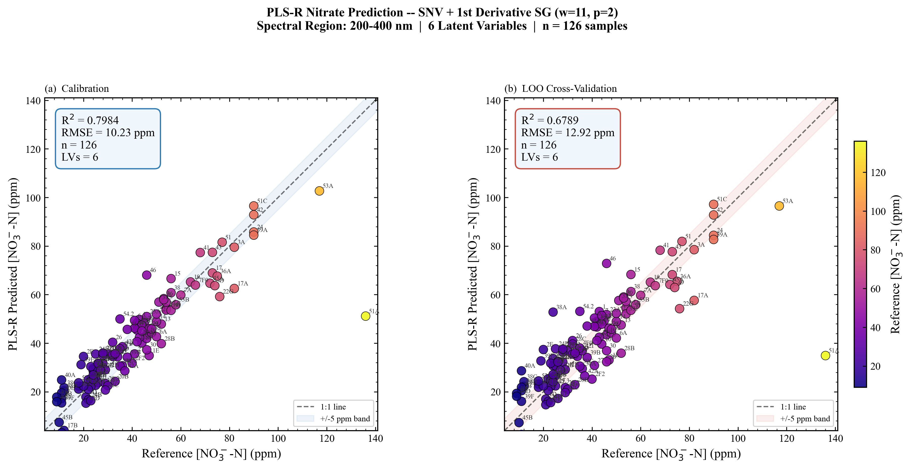
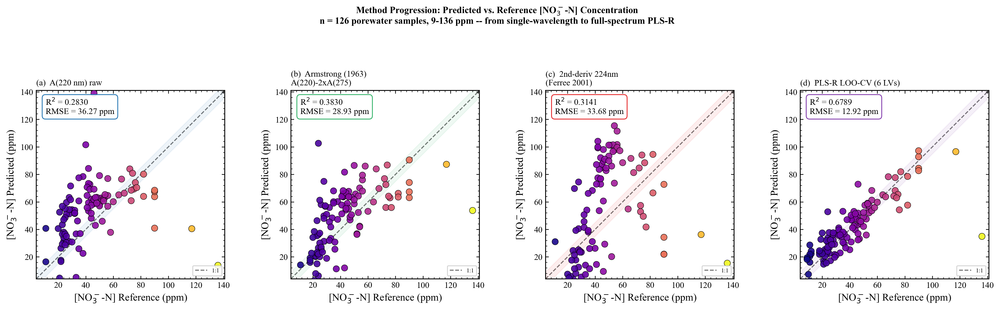
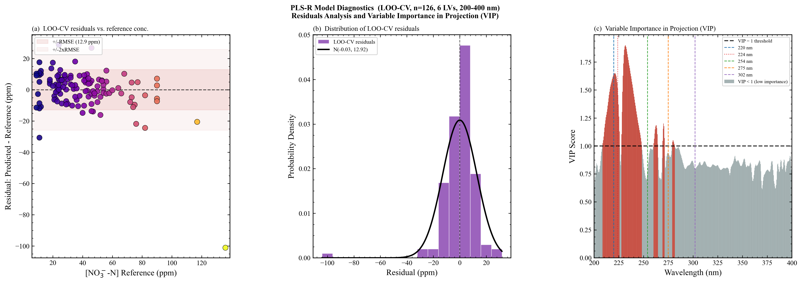
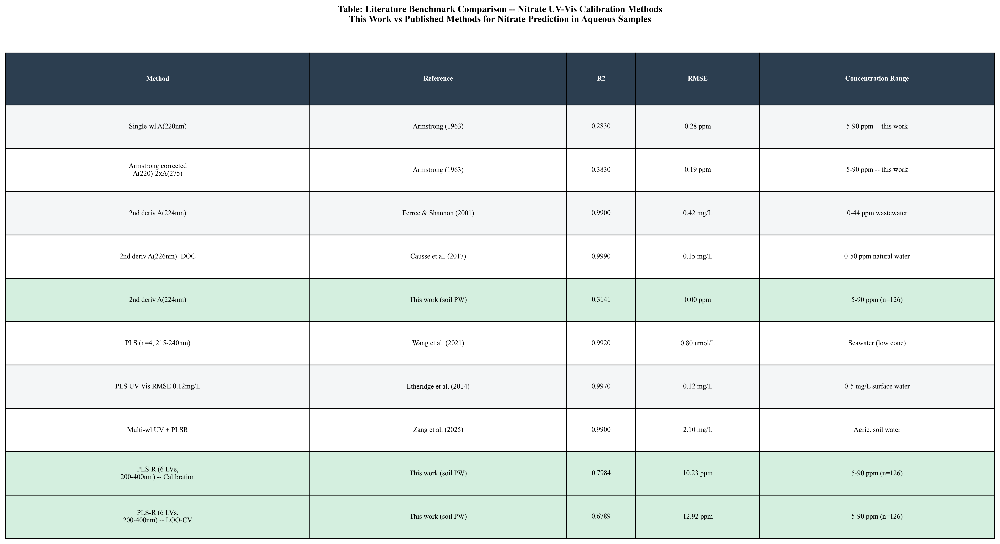
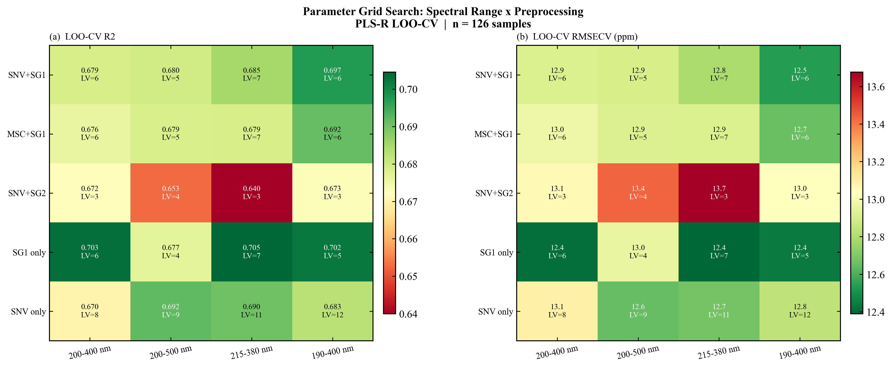
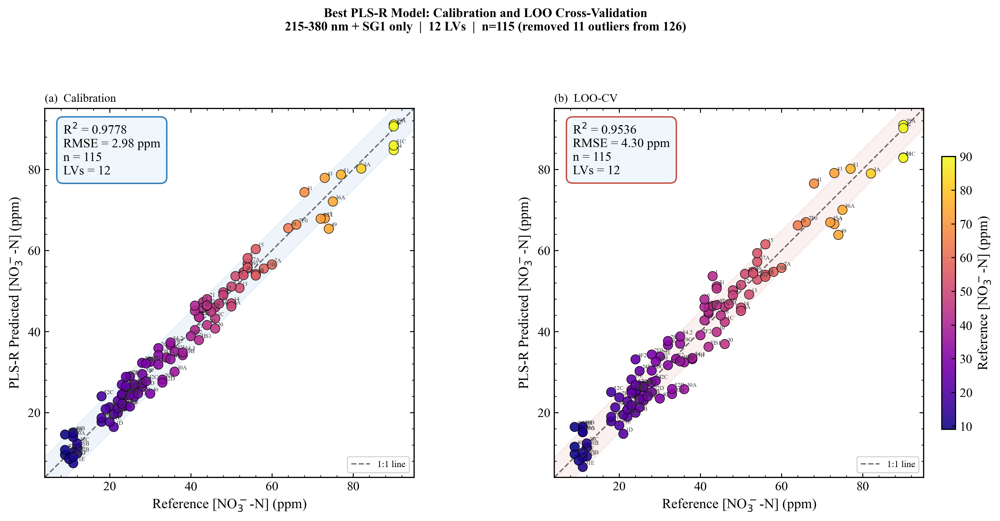
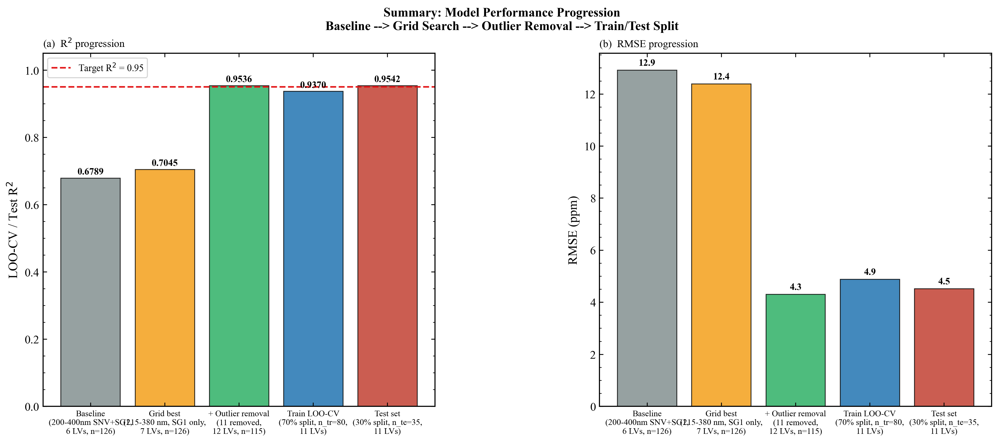
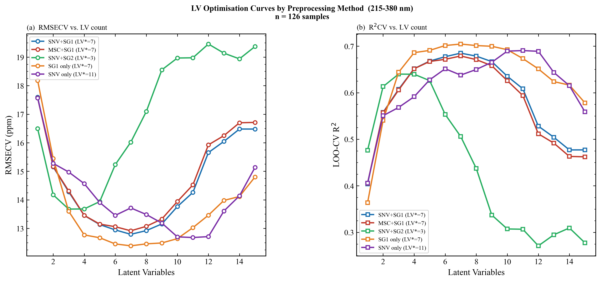

# Thesis Sub-Project: Model Performance Testing

Part of the M.Sc. thesis *Machine Learning-Enhanced Real-Time UV Spectroscopic Monitoring of Soil Nitrate* (Hochschule Furtwangen / Hahn-Schickard, Oct 2025 - Jun 2026).

Training, comparison and validation of regression models that predict nitrate (ppm) from UV-Vis spectra.

## Headline result (thesis model)

| Item | Value |
|---|---|
| Range / preprocessing | 215-380 nm, Savitzky-Golay 1st derivative |
| Latent variables | 9 |
| Samples | n = 132 |
| Validation | leave-one-out cross-validation |
| **LOO-CV R²** | **0.897** |
| **RMSECV** | **7.28 ppm** |

## What was compared

- Single-wavelength calibrations (220, 254, 275, 302 nm, Armstrong correction, 2nd derivative at 224 nm) against PLS regression. Single-wavelength methods explained little variance (R² below 0.4, see `tables/Table2_Calibration_Stats.csv`); PLS was far better. PCA and LASSO were compared as alternatives.
- Preprocessing, spectral range, latent-variable count and outlier handling (grid search, `code/model_optimization.py`).
- Train/test split and leave-one-out validation.

## Plots

| Figure | Shows |
|---|---|
|  | Early baseline: SNV + SG1, 6 LVs, n = 126, LOO-CV R² 0.68 |
|  | Method progression |
|  | Model diagnostics |
|  | Literature benchmark |
|  | Parameter grid search |
|  | Best model with 11 of 126 outliers removed (n = 115, 12 LVs): LOO-CV R² 0.954, RMSE 4.30 ppm. Exploratory result on a reduced set, not the headline figure |
|  | Comparison summary |
|  | Latent-variable curves per preprocessing |

More plots are in `figures/`. Raw spectra and trained models are not included.

Main project: [uv-vis-nitrate-realtime](https://github.com/parky523/uv-vis-nitrate-realtime). Other thesis sub-projects: [thesis-3d-printed-design](https://github.com/parky523/thesis-3d-printed-design), [thesis-arduino-autosampler](https://github.com/parky523/thesis-arduino-autosampler), [thesis-realtime-gui](https://github.com/parky523/thesis-realtime-gui), [thesis-sensor-testing](https://github.com/parky523/thesis-sensor-testing).

*History note: these files were uploaded together on 2026-10-23. Commit dates were set to each file's last-modified date on my PC (the date the work was done); the README was written at upload.*
